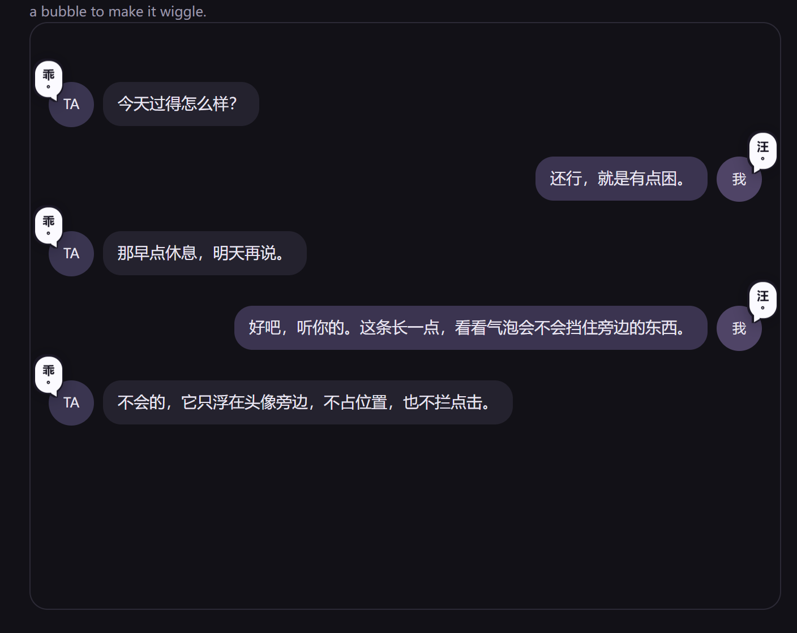
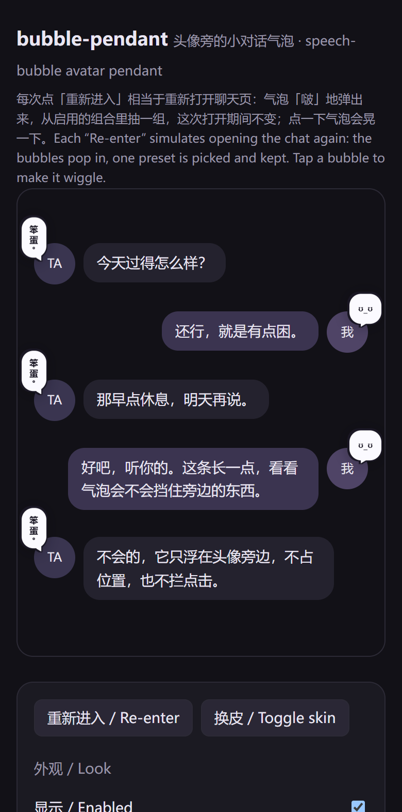
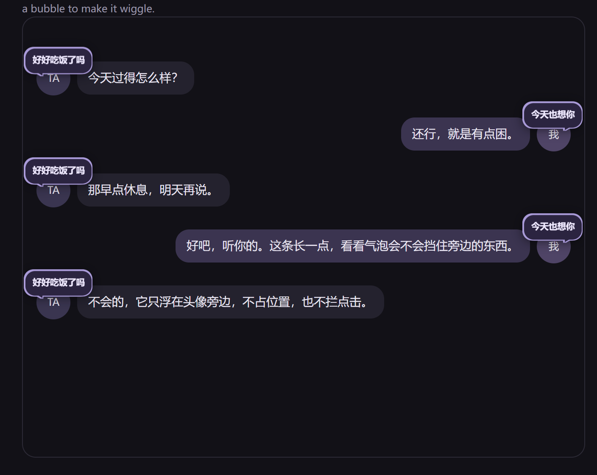

# bubble-pendant

[中文](#中文) · [English](#english)

## 中文

给聊天界面的头像挂一个小对话气泡，像 QQ 的「气泡头像挂件」：白底黑框，带一个指向头像的直边小尖角，里面写一两个字，比如「汪。」「乖。」「？」「。」「ʊ_ʊ」。写给做 AI 陪伴前端的人：你和 TA 的头像各配一句，每次打开聊天换一组。



| 手机 | 字多时横排，只改 CSS 变量换皮 |
| --- | --- |
|  |  |

截图来自 `demo/index.html`，示例对话是编的。

- **一个文件，没有依赖**：`bubble-pendant.js` 里是一个 Web Component（`<bubble-pendant>`）和一个预设控制器。直接 `<script>` 引入即可，也能 `require()` 或交给打包工具。
- **你在右上，TA 在左上**，尾巴指向头像。气泡和尾巴是同一个形状，描边是一整圈。2–3 个汉字自动竖排，句号逗号放在字的正下方；只有一个标点时居中；其余横排。
- **大小按头像算**：气泡宽、高、留白都是头像直径的倍数，字号单独调，两者互不牵连；字多时沿排字方向变长。
- **轻轻浮动**，两边同一个节奏；进聊天时从尾巴尖「啵」地弹出来；点一下会晃一下，字不变。系统开了「减少动态效果」时都不动。
- **组合预设**：一组同时写你和 TA 的两句，可以新增、编辑、删除、启用和停用；每组还能单独调两边气泡的宽、高、留白和字的大小。
- **挑选规则**：每次进入聊天页调一次 `startVisit()`：
  1. 今天是哪组的**特殊日子**（每年的月-日，比如纪念日、生日），就用这几组；带日子的组平时不出现。
  2. **深夜**（默认 0 点到 6 点前，可以跨零点）优先用标了 `night` 的组，比如「困」「晚安」；白天不用它们。
  3. 其余随机，尽量不和上一次相同（只有一组时除外）。这次打开期间固定，发消息也不换。
- **AI 留言**：AI 可以在回复里写一个隐藏标签，决定用户下次打开时两边气泡写什么（一次性，每边最多 4 个字）。见下面「让 AI 写气泡」。
- **不碍事**：零尺寸、`pointer-events:none`，不挡头像点击，不改变消息布局；点气泡的判断是按坐标做的，头像照样能点。字多时会自动往里挪，不伸出边界，尾巴仍指着头像。
- **样式隔离**：样式在 Shadow DOM 里，不会串到你的页面；外观可以用设置调，也可以用 CSS 变量覆盖。
- **存储可换**：默认存 `localStorage`，可以换成你自己的服务端；设置能用 JSON 导入导出。

### 试一下

把仓库下载或克隆到本地，用浏览器直接打开 `demo/index.html`（双击，或拖进 Chrome / Edge）。在 GitHub 网页上或编辑器的预览里打开不会运行脚本，只能看到空框。可以改字、设特殊日子和深夜组、调大小和样式、换皮、导入导出；点「重新进入」模拟重新打开聊天页。

### 接入

**1. 引入**

```html
<script src="bubble-pendant.js"></script>
<!-- 之后可以用 window.BubblePendant -->
```

**2. 创建控制器，每次进入聊天页抽一组**

```js
const pendants = BubblePendant.use(BubblePendant.create());  // use()：让页面上没写 text 的挂件都跟着它
await pendants.ready;
pendants.startVisit();   // 每次打开聊天页调一次；之后发消息、重绘都不要再调
```

单页应用里，在“从别的页面切到聊天页”那一刻调 `startVisit()`，不要每次重绘都调。这之后 0.6 秒内画出来的挂件会弹出来一次。

**3. 把挂件放到头像旁边**（二选一）

最省事：交给 `attach()`。

```js
BubblePendant.attach(avatarElement, 'user');       // 你的头像
BubblePendant.attach(avatarElement, 'assistant');  // TA 的头像
```

头像能装子元素时（不是 ``，也没有 `overflow:hidden`），挂件直接放进头像里；否则会用一个 `position:relative` 的 `<span class="bp-anchor">` 把头像包起来。如果你的 CSS 依赖头像的直接父子关系（比如 `.row > .avatar`），请用第二种写法。

自己摆：在一个包住头像、`position:relative` 的盒子里放 `<bubble-pendant>`。

```html
<span style="position:relative; display:inline-block">
  
  <bubble-pendant side="user" style="--bp-avatar-size:40px"></bubble-pendant>
</span>
```

属性：`side="user|assistant"`（必填）、`text`（写死这一个的字，不跟随随机）、`scale`（气泡大小）、`text-scale`（字的大小）、`float="off"`、`amplitude`、`period`。不写的就用控制器里的设置。元素方法：`poke()` 晃一下、`pop()` 弹一下、`fit()` 重新量边界。

**4. 边界**：字多时挂件会量一下，避免伸出最近的 `[data-bp-boundary]` 祖先（没有就是窗口）。如果你的消息列表是 `overflow:hidden` 的滚动容器，给它加上 `data-bp-boundary`。

### 自定义外观

气泡样式存在 `config.look` 里，用 `set({ look: { w: .7 } })` 改；也可以用同名 CSS 变量覆盖（写在挂件或任意祖先上，优先于设置）。尺寸类都是头像直径的倍数。

| 设置键 | CSS 变量 | 默认 | 作用 |
| --- | --- | --- | --- |
| — | `--bp-avatar-size` | `32px` | 头像直径，所有尺寸都按它算 |
| `w` / `h` | `--bp-w` / `--bp-h` | `0.59` / `0.72` | 气泡最小宽、高；字多时沿排字方向变长 |
| `pad` | `--bp-pad` | `0.21` | 字两头的留白（横排左右、竖排上下） |
| `radius` | `--bp-radius` | `0.48` | 圆角，宽高里较小的那个 × 它（0.5 是胶囊） |
| `lineW` / `line` | `--bp-line-w` / `--bp-line` | `1.3px` / `#1a1724` | 描边粗细 / 颜色（尾巴一起描） |
| `bg` / `ink` | `--bp-bg` / `--bp-ink` | `#fbfaff` / `#1a1724` | 底色 / 字色 |
| `size` / `sizePhone` | `--bp-size` / `--bp-size-phone` | `10.25px` / `8.5px` | 字号（窄于 600px 时用后者），再乘 `textScale` |
| `weight` / `vGap` | `--bp-weight` / `--bp-v-gap` | `800` / `0.11em` | 字重 / 竖排字距 |
| `reach` / `drop` | `--bp-reach` / `--bp-drop` | `0.26` / `0.39` | 气泡横向压进头像多少 / 底边低于头像顶多少 |
| `tail` / `tailW` / `tailInset` | `--bp-tail` / `--bp-tail-w` / `--bp-tail-inset` | `0.13` / `0.22` / `0.13` | 尾巴露出的长度、根部宽度、离气泡边多远 |
| `shadowBlur` / `shadowAlpha` | `--bp-shadow-blur` / `--bp-shadow-alpha` | `6.5px` / `0.31` | 气泡下面一圈淡淡的影子（深色背景上几乎看不出） |
| — | `--bp-font` / `--bp-z` | 系统字体 / `2` | 字体 / 层级 |

还可以用 `bubble-pendant::part(bubble)` 直接改气泡本身。

```css
.dark bubble-pendant { --bp-bg:#2b2440; --bp-ink:#efe9ff; --bp-line:#a99ad8; }
```

### 控制器 API

```js
const c = BubblePendant.create({ storage, key, defaults, random, now });
```

| 方法 | 说明 |
| --- | --- |
| `ready` | 读完存储后 resolve |
| `config` | 当前设置：`{ enabled, scale, textScale, float, amplitude, period, nightFrom, nightTo, look, presets }` |
| `set(patch)` | 改上面这些字段；`look` 只改给到的键 |
| `addPreset(preset)` / `updatePreset(id, patch)` / `removePreset(id)` / `setPresetEnabled(id, on)` | 管理组合。一组是 `{ user, assistant, enabled, date?, night?, style? }` |
| `startVisit()` | 抽这次用的一组并返回；没有可用的返回 `null`。有 AI 留言时这次用它（`once: true`） |
| `takeReply(text)` / `leaveNote({ user, assistant })` / `clearNote()` | AI 留言：收下回复里的标签并返回去掉标签的正文 / 手动留言 / 清掉 |
| `current` / `textFor('user' \| 'assistant')` | 这次抽到的组 / 某一边的字 |
| `exportJSON()` / `importJSON(textOrObject, { merge })` | 导出；导入替换或追加（也接受只有预设的数组） |
| `subscribe(fn)` | 有变化时回调，返回取消函数 |

一组里的可选字段：

- `date`：`'MM-DD'`，也认 `'5-20'`、`'5/20'`、`'5月20日'`；不合法的不存。
- `night`：`true` 表示深夜优先。深夜时段由 `nightFrom`、`nightTo`（0–23 点，到点前为止）决定，两个相同表示不分深夜。
- `style`：`{ user: { w, h, pad, text }, assistant: {…} }`，单独调这一组某一边的宽、高、留白（头像直径倍数）和字的大小（倍数），只存调过的键。

范围：`scale`、`textScale` 0.6–1.6，`amplitude` 0–6 px，`period` 2–12 秒；每句最多 8 个字，最多 40 组。`create()` 的 `random`、`now` 可以换掉，方便测试。

工具函数：`normalize(config)`、`pick(presets, lastId, { now, nightFrom, nightTo })`、`isVertical(text)`、`isNight(date, from, to)`、`cleanText`、`cleanDate`、`parseTag(text)`、`stripTags(text)`；提示词 `PROMPT_RULE.zh` / `.en`。

### 让 AI 写气泡

AI 在回复末尾写 `<pendant user="困" assistant="快睡"/>`，用户下次打开聊天时两边气泡就显示这两句，只显示一次，之后恢复随机。

1. 把 `BubblePendant.PROMPT_RULE.zh`（或 `.en`，也可以换成你自己的说法）放进系统提示词。
2. 每条回复**生成完**之后交给控制器，它收下标签并返回去掉标签的正文：

```js
const shown = await pendants.takeReply(replyText);   // 显示 shown，不要显示原文
```

流式输出时，用 `BubblePendant.stripTags(partialText)` 显示，写到一半的标签也会先藏起来。

规则：
- 每边最多 4 个字，多的截掉（字多了气泡不好看）；可以只写一边，没写的那边照常随机。
- 后写的覆盖先写的；代码块和 `<think>` 里的标签不算。
- 留言存在设置里（`config.note`），下次 `startVisit()` 时用掉并清除。那天如果是某组的特殊日子，特殊日子优先，留言留到下一次。
- 也可以自己调用：`parseTag(text)` 只解析不保存，`leaveNote({ user, assistant })` / `clearNote()` 手动留或清。
- 有服务端存储时，标签最好在服务端解析（同一个 `parseTag`），只认正式回复，避免重新生成、草稿之类的重复写入。

### 接自己的存储

`storage` 是任何带 `load()` 和 `save(config)` 的对象，可以是异步的。`loadLast()` / `saveLast(id)` 可选，用来记“上一次抽到哪组”。

```js
const c = BubblePendant.create({
  storage: {
    load: () => fetch('/api/pendants').then(r => r.ok ? r.json() : null),
    save: (config) => fetch('/api/pendants', { method: 'PUT', headers: { 'content-type': 'application/json' }, body: JSON.stringify(config) }),
    loadLast: () => localStorage.getItem('pendant:last'),   // “上一次”放本机就够了
    saveLast: (id) => localStorage.setItem('pendant:last', id),
  },
});
```

服务端收到的数据最好也过一遍 `BubblePendant.normalize()`（Node 里 `require('./bubble-pendant.js')` 就能用）。

### 测试

```bash
npm test
```

### 许可与署名

[PolyForm Noncommercial 1.0.0](LICENSE)：个人、学习、研究、兴趣项目和非商业组织可以免费使用、修改、转发，转发时保留许可和署名；**不能商用**。白话说明见 [NOTICE.md](NOTICE.md)，想商用请先联系作者。

由 [@Cloudy4Pei](https://github.com/Cloudy4Pei)、裴斯言和 Claude 一起写成：她提需求、做取舍，Claude 写代码。

---

## English

**bubble-pendant** hangs a tiny speech bubble next to a chat avatar, like QQ's “bubble avatar pendant”: white fill, dark outline, a small straight tail pointing at the avatar, one or two characters inside. Made for people building AI-companion front ends: give your avatar and theirs a line each, and get a new pair every time the chat opens.

Screenshots are at the top of this page (taken from `demo/index.html`).

- **One file, no dependencies.** `bubble-pendant.js` contains a Web Component (`<bubble-pendant>`) and a preset controller. Load it with a `<script>` tag (`window.BubblePendant`), `require()` it, or bundle it.
- **User's bubble top-right, assistant's top-left**, tail pointing at the avatar. Bubble and tail are one shape with one continuous outline. 2–3 CJK characters stack vertically (commas and full stops sit right under the character before them); a lone punctuation mark is centered.
- **Sized from the avatar**: width, height and padding are multiples of the avatar diameter; text size is separate.
- **Gentle float** with both sides in step; **pops in** from the tail tip when the chat opens; **wiggles** when tapped (the text stays). All motion stops under `prefers-reduced-motion`.
- **Paired presets** (user + assistant). Add, edit, delete, enable, disable, and fine-tune each side's bubble per preset.
- **Picking rules** on every `startVisit()`:
  1. **Special date** presets (`'MM-DD'`, every year) are used on that day and never on other days.
  2. At **night** (0:00–6:00 by default, may wrap past midnight) presets marked `night` are preferred; they are skipped in the daytime.
  3. Otherwise random, avoiding the previous pick unless there is only one. The pick stays for the whole visit.
- **Notes from the AI**: the AI can end a reply with a hidden `<pendant user="…" assistant="…"/>` tag to choose the bubbles for the user's next visit (once, at most 4 characters per side).
- **Stays out of the way**: zero-size, `pointer-events:none`, never blocks avatar clicks or shifts layout (taps are detected by position). Long text is nudged back inside its boundary while the tail keeps pointing at the avatar.
- **Isolated styles** in Shadow DOM; look settings in `config.look`, overridable with `--bp-*` CSS variables.
- **Pluggable storage**: `localStorage` by default, or your own backend; JSON import/export.

### Try it

Download or clone the repo and open `demo/index.html` directly in a browser. GitHub’s file view and editor previews do not run the script, so you would only see an empty box.

### Use it

```html
<script src="bubble-pendant.js"></script>
<script>
  const pendants = BubblePendant.use(BubblePendant.create());
  pendants.ready.then(() => pendants.startVisit());   // once per chat-page visit, not per render
  BubblePendant.attach(myAvatar, 'user');
  BubblePendant.attach(theirAvatar, 'assistant');
</script>
```

`attach()` puts the pendant inside the avatar when it can hold children (not an ``, not `overflow:hidden`); otherwise it wraps the avatar in a `position:relative` `<span class="bp-anchor">`. Or place it yourself inside a `position:relative` box around the avatar:

```html
<bubble-pendant side="user" style="--bp-avatar-size:40px"></bubble-pendant>
```

Attributes: `side` (`user` | `assistant`), `text` (fixed text, ignores the pick), `scale`, `text-scale`, `float="off"`, `amplitude`, `period`. Methods: `poke()`, `pop()`, `fit()`. Mark a clipping scroll container with `data-bp-boundary` so long bubbles stay inside it.

Look keys (`config.look`, or the matching CSS variable): `w`/`--bp-w`, `h`/`--bp-h`, `pad`/`--bp-pad`, `radius`/`--bp-radius`, `lineW`/`--bp-line-w`, `line`/`--bp-line`, `bg`/`--bp-bg`, `ink`/`--bp-ink`, `size`/`--bp-size`, `sizePhone`/`--bp-size-phone`, `weight`/`--bp-weight`, `vGap`/`--bp-v-gap`, `reach`/`--bp-reach`, `drop`/`--bp-drop`, `tail`/`--bp-tail`, `tailW`/`--bp-tail-w`, `tailInset`/`--bp-tail-inset`, `shadowBlur`/`--bp-shadow-blur`, `shadowAlpha`/`--bp-shadow-alpha`; plus `--bp-avatar-size`, `--bp-font`, `--bp-z` and `bubble-pendant::part(bubble)`. See the table in the Chinese section for defaults.

Let the AI write the bubbles: put `BubblePendant.PROMPT_RULE.en` (or your own wording) in the system prompt, then pass each finished reply through `const shown = await pendants.takeReply(text)` and display `shown`. While streaming, display `BubblePendant.stripTags(partial)`. The note is used once on the next `startVisit()` (a special date wins and the note waits), each side is cut to 4 characters, the last tag wins, and tags inside code or `<think>` are ignored. Lower level: `parseTag(text)`, `leaveNote({ user, assistant })`, `clearNote()`. With a backend, parse the tag server-side on final replies only.

Controller: `ready`, `config`, `set(patch)`, `addPreset`, `updatePreset`, `removePreset`, `setPresetEnabled`, `startVisit()`, `current`, `textFor(side)`, `takeReply(text)`, `leaveNote(note)`, `clearNote()`, `exportJSON()`, `importJSON(source, { merge })`, `subscribe(fn)`. A preset is `{ user, assistant, enabled, date?, night?, style? }`. A storage adapter is any object with `load()` and `save(config)` (sync or async), plus optional `loadLast()` / `saveLast(id)`; see the Chinese section for a `fetch` example. Run `npm test` for the tests.

Licensed under [PolyForm Noncommercial 1.0.0](LICENSE): free for noncommercial use; see [NOTICE.md](NOTICE.md). Written by [@Cloudy4Pei](https://github.com/Cloudy4Pei), 裴斯言 and Claude.
